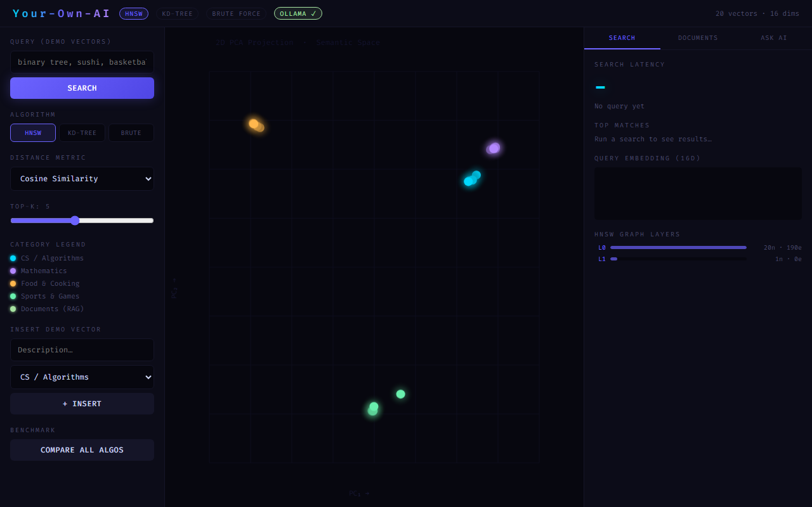
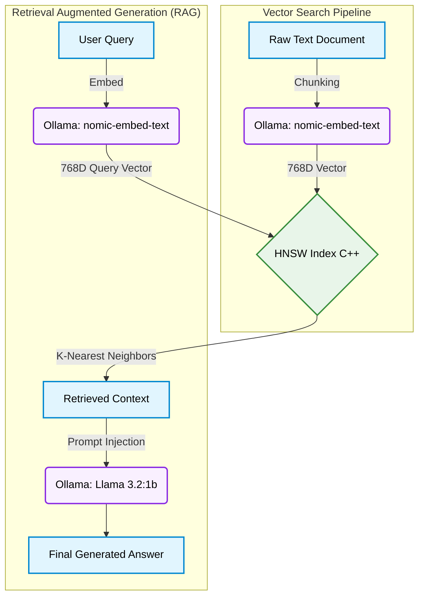

<p align="center">
  
</p>

# Your Own AI

A fully working vector database with HNSW, KD-Tree, and Brute Force search, plus a local RAG pipeline powered by Ollama.



---

## Overview

Your Own AI is a lightweight C++ vector database built from scratch to benchmark nearest neighbor search structures and power an offline Retrieval-Augmented Generation (RAG) pipeline. The database implements Hierarchical Navigable Small World (HNSW) graphs, spatial KD-Trees, and linear Brute-Force scanning across Cosine, Euclidean, and Manhattan distance metrics.

A built-in single-header HTTP server serves a web dashboard with real-time 2D Principal Component Analysis (PCA) vector projection, and integrates with local Ollama instances (`nomic-embed-text` and `llama3.2:1b`) to ingest, chunk, embed, index, and query custom documents completely locally.

---

## Architecture Overview



**Index Implementations:**
- **HNSW (Hierarchical Navigable Small World):** Multi-layer proximity graph zooming from sparse long-range highway edges to dense base layers, maintaining $O(\log N)$ query complexity in high dimensions.
- **KD-Tree:** Axis-aligned binary partitioning providing exact search for low dimensions ($\le 20D$).
- **Brute Force:** Exhaustive $O(N \cdot d)$ linear scan used as a deterministic baseline.

---

## Features

| Feature | Description |
| ------- | ----------- |
| **3 Indexing Algorithms** | HNSW, KD-Tree, and Brute Force with simultaneous head-to-head benchmarking |
| **3 Distance Metrics** | Cosine similarity, Euclidean ($L_2$) distance, and Manhattan ($L_1$) distance |
| **2D PCA Projection** | Real-time dimensionality reduction projecting semantic vector spaces onto an interactive scatter plot |
| **Document Ingestion** | Splits text documents into overlapping 250-word windows and extracts 768-dimensional embeddings |
| **Local RAG Workflow** | End-to-end question answering pipeline pairing HNSW context retrieval with local Ollama LLMs |
| **Embedded REST API** | REST endpoints for vector insertion, deletion, nearest neighbor queries, and graph statistics |

---

## Technology Stack

| Component | Technology |
| --------- | ---------- |
| Core Language | C++17 |
| Build System | CMake 3.16+ / GCC (MinGW-w64) |
| HTTP Server | `cpp-httplib` (single-header C++) |
| Local AI Engine | Ollama (`nomic-embed-text`, `llama3.2:1b`) |
| Web Frontend | HTML5, CSS3, JavaScript, HTML Canvas (PCA projection) |
| Testing & Linting | C++ test harness, ruff |

---

## Project Structure

```
Your-Own-AI/
├── src/
│   └── main.cpp              # C++ database engine, index structures, HTTP server, and RAG logic
├── include/
│   └── httplib.h             # Embedded HTTP server library
├── tests/
│   └── test_vector_engine.cpp# Index accuracy and distance metric test suite
├── index.html                # Interactive frontend dashboard and PCA visualization
├── CMakeLists.txt            # Build specification
├── create_colab.py           # Helper script for remote GPU notebook initialization
└── README.md
```

---

## Setup and Installation

### Prerequisites

- A C++17 compatible compiler (`g++` via MSYS2 on Windows, or `g++`/`clang++` on Linux/macOS)
- [CMake 3.16+](https://cmake.org/)
- [Ollama](https://ollama.com/) installed and running locally

### 1. Pull Ollama Models

```bash
ollama pull nomic-embed-text   # 768D text embedding model (~274 MB)
ollama pull llama3.2:1b        # Quantized local reasoning LLM (~1.3 GB)
```

### 2. Clone the repository

```bash
git clone https://github.com/Shashank17singh/Your-Own-AI.git
cd Your-Own-AI
```

### 3. Compile the C++ Server

Using CMake:

```bash
cmake -B build
cmake --build build --config Release
```

Or compiling directly with g++:

```bash
g++ -std=c++17 -O2 -Iinclude src/main.cpp -o build/vectordb.exe -lws2_32
```

### 4. Run the application

Ensure Ollama is active (`ollama serve`), then launch the vector database binary:

```bash
./build/vectordb.exe
```

Open your browser to `http://localhost:8080`.

---

## Using the Application

### 1. Semantic Vector Search

- Search concept spaces across the pre-loaded 16D semantic vectors (Computer Science, Mathematics, Food, Sports).
- Toggle between **HNSW**, **KD-Tree**, and **Brute Force** to compare lookup latency and distance rankings.
- Watch clusters emerge in real time on the 2D PCA scatter plot.

### 2. Document Indexing

- Input arbitrary text (lecture notes, documentation, articles).
- The pipeline generates 768-dimensional embeddings via `nomic-embed-text` and indexes chunks into the HNSW graph.

### 3. Contextual RAG Inquiries

- Submit domain questions in the **Ask AI** tab.
- The engine computes query embeddings, retrieves the top-$k$ nearest neighbors via HNSW, injects context into `llama3.2:1b`, and streams the grounded answer.

---

## REST API Reference

| Method | Endpoint | Description |
| ------ | -------- | ----------- |
| `GET` | `/search?v=...&k=5&metric=cosine&algo=hnsw` | Nearest neighbor vector search |
| `POST` | `/insert` | Insert custom vector with metadata |
| `DELETE` | `/delete/:id` | Remove vector by identifier |
| `GET` | `/items` | List all indexed vectors |
| `GET` | `/benchmark?v=...&k=5&metric=cosine` | Run speed comparison across all three algorithms |
| `GET` | `/hnsw-info` | Inspect HNSW graph layers and neighbor distributions |
| `POST` | `/doc/insert` | Embed and index text chunks |
| `POST` | `/doc/ask` | Execute RAG retrieval and generation |
| `GET` | `/status` | Verify Ollama connectivity and loaded models |

### Example Query via curl

```bash
curl "http://localhost:8080/search?v=0.9,0.8,0.7,0.6,0.1,0.1,0.1,0.1,0.1,0.1,0.1,0.1,0.1,0.1,0.1,0.1&k=3&metric=cosine&algo=hnsw"
```

---

## Running the Tests

Compile and run the vector engine test suite:

```bash
cmake -B build -DBUILD_TESTS=ON
cmake --build build
./build/test_vector_engine
```

Run static code analysis on utility scripts:

```bash
ruff check .
```

---

## Deployment

The database is built as a single, zero-dependency native binary (linking only standard system sockets `ws2_32` on Windows or `pthread` on Linux). For containerized environments:

```bash
docker build -t your-own-ai .
docker run -p 8080:8080 your-own-ai
```

---

## Known Limitations

- KD-Tree performance degrades in high-dimensional vector spaces ($d > 20$) due to the curse of dimensionality; HNSW is recommended for 768D text embeddings.
- Vector persistence is currently kept in-memory; graph state is re-indexed on process restart unless saved via snapshot checkpoints.

---

## License

This project is licensed under the MIT License. See [LICENSE](LICENSE) for details.
